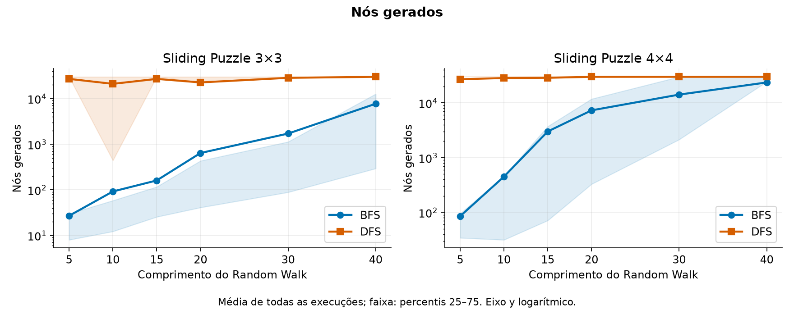
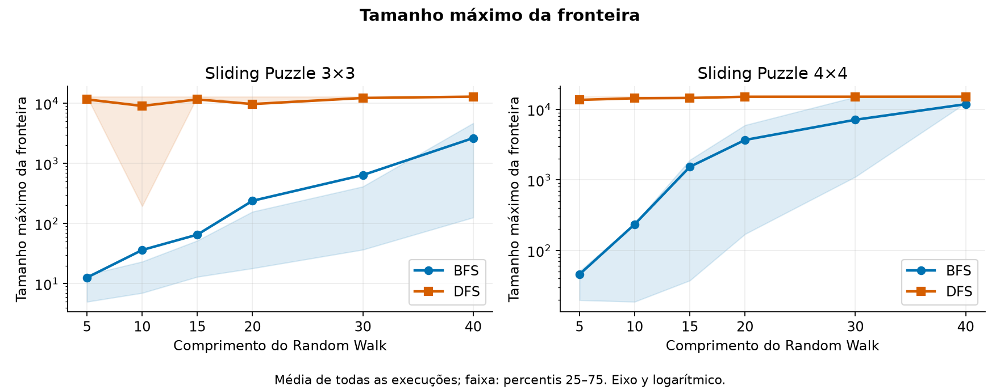
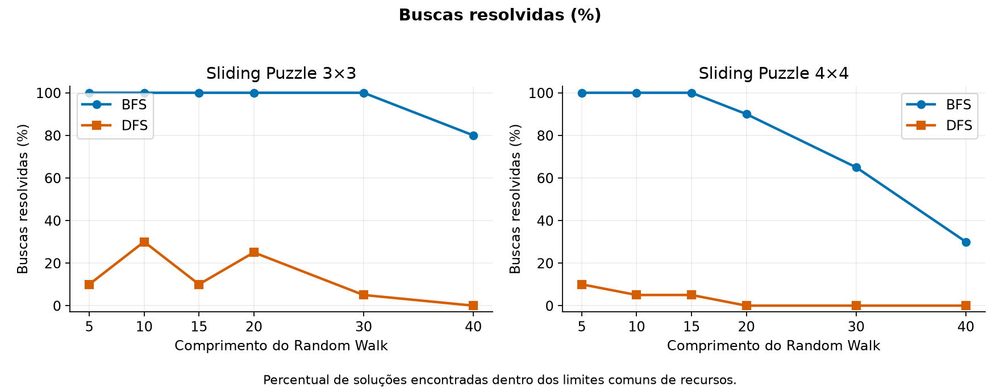

# Comparação experimental de BFS e DFS no Sliding Puzzle

## Pergunta de pesquisa

Como BFS e DFS, com controle de estados repetidos, diferem em tempo de execução, número de nós gerados e tamanho máximo da fronteira ao resolver Sliding Puzzles 3×3 e 4×4, sob os mesmos limites de recursos?

## Experimentos

Foi utilizada a biblioteca da Equipe A, obtida de `GustavoFelipeM/search_lib`, commit `8f119b004890be5109d3fae975670d9fbd0c49a7`. As abstrações State, Action, Problem, SearchNode e métricas foram mantidas. Os algoritmos foram adaptados de tree-search para graph-search: os estados são registrados ao entrar na fronteira e não são inseridos novamente. BFS utiliza uma fila FIFO; DFS utiliza uma pilha LIFO. Ambos têm o mesmo teste de objetivo na remoção da fronteira e visitam sucessores na ordem cima, baixo, esquerda e direita. Cada movimento custa 1. DLS não faz parte do estudo.

O fator principal é a estratégia (BFS ou DFS), cruzada com a dimensão do problema (3×3 ou 4×4). O comprimento do Random Walk é um estrato de geração de entradas: 5, 10, 15, 20, 30 e 40 movimentos. Em cada combinação de tamanho e comprimento, foram usadas 20 sementes, de 42 a 61. Isso totaliza **240 instâncias pareadas e 480 buscas**. Cada instância foi aplicada aos dois algoritmos sem alteração; a ordem de execução alternou entre as rodadas. As 20 rodadas representam diferentes sementes, não repetições de medição do mesmo tabuleiro.

Os estados iniciais foram gerados a partir do objetivo ordenado, com o vazio no canto inferior direito, escolhendo uniformemente um movimento legal por passo. Todos são solucionáveis. Retornos e ciclos são permitidos; o comprimento do passeio não mede a distância ótima. Foram mantidas 8 instâncias já no objetivo. A reutilização de sementes faz com que comprimentos diferentes possam compartilhar prefixos do passeio; as observações não devem ser tratadas como independentes entre todos os estratos.

O orçamento foi de **30.000 estados admitidos e 2 segundos por busca**. A interrupção por nós ocorre na tentativa de admitir o próximo estado. Assim, uma solução ainda na fronteira pode não ser encontrada antes da interrupção. Execuções interrompidas permanecem nos resultados, com custo vazio e status explícito. A coleta foi feita em Windows 11, Python 3.14.6, em 19/10/2026. Trata-se de uma execução local sem isolamento de carga do sistema; não foram feitas repetições temporais nem testes de significância.

Nós gerados são estados distintos admitidos, incluindo a raiz; tamanho máximo da fronteira é o pico de nós aguardando exploração. O tempo de relógio foi medido com `perf_counter`, excluindo geração e exportação, mas incluindo instrumentação por `tracemalloc`. O pico de memória Python, nós expandidos e custo também constam no CSV. Memória Python não equivale ao RSS total. As figuras usam médias de todas as execuções, inclusive interrompidas; as faixas mostram percentis 25–75, não intervalos de confiança. O eixo vertical das três métricas principais é logarítmico.

## Resultados

| Tabuleiro | Busca | Soluções | Tempo médio (s) | Nós gerados médios | Fronteira máxima média |
|---|---|---:|---:|---:|---:|
| 3x3 | BFS | 116/120 | 0.0342 | 1722.1 | 607.1 |
| 3x3 | DFS | 16/120 | 0.4887 | 26021.0 | 11221.6 |
| 4x4 | BFS | 97/120 | 0.1516 | 8122.3 | 4080.9 |
| 4x4 | DFS | 4/120 | 0.5637 | 29065.5 | 14647.6 |

No total, BFS resolveu **213/240** instâncias e DFS resolveu **20/240**. Os status registrados foram: node_limit: 247, solved: 233. Atingir um limite indica falta de solução dentro do orçamento, não insolubilidade. O teto de nós também comprime diferenças entre execuções difíceis: valores próximos de 30.000 refletem o protocolo de interrupção.


**Figura 1 — Tempo.** As médias devem ser lidas junto à taxa de sucesso: elas medem esforço até solução ou interrupção, não tempo necessário para resolver todas as entradas. A instrumentação e a carga do computador afetam os tempos absolutos.



**Figura 2 — Nós gerados.** O gráfico explicita o custo de exploração e a saturação no limite. O DFS pode seguir ramos longos mesmo quando o estado inicial foi obtido com poucos movimentos; BFS explora por camadas e beneficia-se de soluções rasas.



**Figura 3 — Fronteira.** O conjunto de estados descobertos e os vínculos de ancestralidade também consomem memória. Portanto, fronteira menor não implica necessariamente menor memória total; não se deve aplicar diretamente a expectativa de memória do DFS em árvore a esta implementação em grafo.



**Figura 4 — Sucesso.** Complemento necessário para interpretar as três métricas. Não se observa necessariamente crescimento monotônico da dificuldade com o passeio, porque retornos são possíveis.

Houve 20 pares resolvidos por ambos; em 12 deles o custo foi igual. Os custos só devem ser comparados nesses pares, evitando comparar médias de conjuntos de sucesso diferentes. Para custos unitários, BFS encontra caminhos mínimos quando conclui; DFS não oferece essa garantia.

## Conclusão e limites

Neste conjunto de entradas e com o orçamento adotado, **BFS apresentou maior cobertura de soluções que DFS**. O resultado é compatível com o benefício da exploração por camadas em estados gerados por passeios relativamente curtos. O DFS, mesmo evitando ciclos, pode investir o orçamento em ramos profundos antes de alcançar o objetivo.

Essa conclusão é restrita às versões graph-search, à ordem de movimentos, às sementes, aos dois tamanhos e aos limites descritos. O experimento não estabelece superioridade universal de BFS, não avalia tree-search e não mede o custo completo das execuções interrompidas. O Random Walk também não produz amostragem uniforme do espaço de estados. Uma extensão seria variar a ordem dos sucessores ou o orçamento, mantendo as mesmas instâncias pareadas.

## Reprodução e arquivos

```bash
python main.py benchmark --sizes 3 4 --depths 5 10 15 20 30 40 --trials 20 --seed 42 --max-nodes 30000 --time-limit 2 --output results/d1.csv
python -m pip install -r requirements-plots.txt
python plot_results.py results/d1.csv --output results/figures
python -B -m unittest discover -s tests -v
```

Dados: [d1.csv](results/d1.csv). Resumo por configuração: [d1.md](results/d1.md). Ambiente e hashes: [d1_metadata.json](results/d1_metadata.json). Origem e adaptações: [SEARCH_LIB_SOURCE.txt](SEARCH_LIB_SOURCE.txt). Os oito testes automatizados passaram; a auditoria dos dados confirmou 240 pares com entradas e limites idênticos e 480 registros completos.
